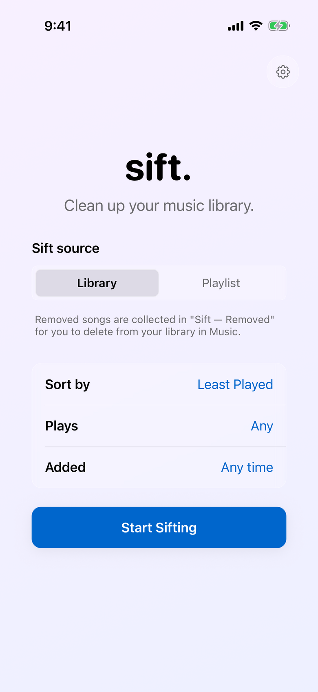
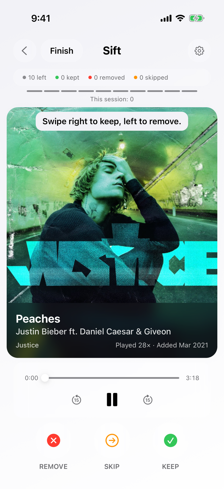
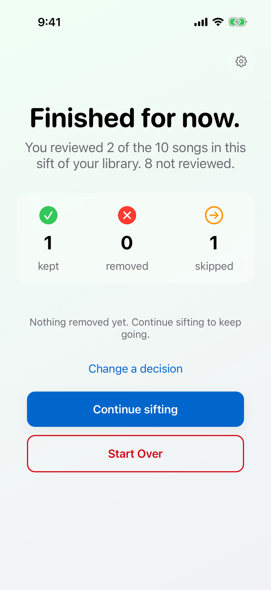
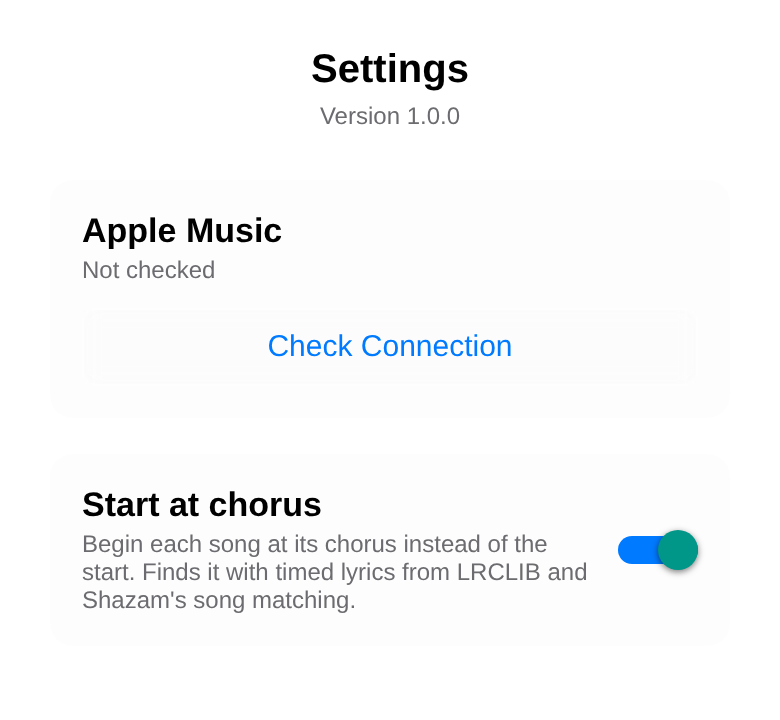

# Sift

**Go through your whole music library, one song at a time.** Swipe through every track you own and decide, in a second each: **Keep**, **Skip**, or **Remove** — with instant playback so you actually hear what you're culling. Works with **Apple Music**, on iPhone and iPad (iOS only: MusicKit has no Android SDK).

Sift is a production-quality React Native (Expo) app built in TypeScript, with a hand-written Swift/MusicKit native module, gesture-driven animations, offline session persistence, and a full CI pipeline.

Its icon is a stack of song cards, the front one marked with Remove and Keep.

---

## Screenshots

| Setup | Sift (swipe) | Done |
|:---:|:---:|:---:|
|  |  |  |
| Pick a source & sort order | The card-swipe deck — the core loop | Session summary with restore & export |

Settings: the optional **Start at chorus** switch (Apple Music).

> Setup, Sift and Done keep themselves current: when a merged PR changes how they look, the iOS Simulator shots CI took of it (the mock music library; native Apple Music access is device-only) come back as a bot PR ([`readme-screenshots.yml`](.github/workflows/readme-screenshots.yml)). The Settings crop is rendered from Expo Web with the same mock provider.

---

## Highlights

- **Custom native Expo module (`modules/expo-musickit`)** — a thin, hand-written Swift module bridging Apple's **MusicKit** into React Native via the Expo Modules API. It exposes primitives: authorization, library and playlist reads and edits, in-app playback through `ApplicationMusicPlayer`, and on-device artwork resolution with a file cache. The decisions live in TypeScript (`src/utils/musicKit.ts`, `src/services/AppleMusicProvider.ts`), so they ship over the air: paging, batching, lookup fallbacks, and the `Sift — Removed` policy (MusicKit can't delete library items, so removals are rerouted into that playlist for the user to clear). A CI check keeps the bridge thin. See [`modules/expo-musickit/ios/ExpoMusicKitModule.swift`](modules/expo-musickit/ios/ExpoMusicKitModule.swift).
- **A music backend behind one interface** — Apple Music (native MusicKit) implements `MusicProviderService`, so another service can be added behind it (a Spotify provider was removed in [#140](https://github.com/jbhirsh/sift/issues/140)). A factory picks it at runtime and falls back to an in-memory mock when no native module is present (Expo Go, CI).
- **Gesture-driven swipe deck** — the card stack is built on `react-native-gesture-handler` + `react-native-reanimated` worklets, with drag rotation, spring-back, and threshold-based Keep/Remove overlays.
- **"Liquid glass" UI** — a reusable blur/material design system (`GlassCard`, `GlassBackground`) with centralized design tokens and automatic light/dark theming.
- **Start at chorus** — an optional setting that starts each song at its most recognizable part. The chorus is found from timed lyrics ([LRCLIB](https://lrclib.net)): the block of lines a song repeats. When that fails, ShazamKit locates Apple Music's preview clip (which labels start at "the good part") inside the full track. Results are cached per song, and the next cards are resolved ahead of time so swiping stays instant.
- **Crash-safe sessions** — all state lives in a single typed `useReducer`; sessions auto-save (debounced) to `AsyncStorage` after every decision and resume exactly where you left off.
- **Undo, and second thoughts** — a decision waits a few seconds before it reaches Apple Music, so Undo takes it back, and the decisions list changes any earlier one.
- **Nothing is deleted behind your back** — a Keep writes nothing to Apple Music, and a Remove only collects the song in "Sift — Removed" for you to delete in Music; Sift edits only the playlists it made.
- **Observability** — Sentry is wired for errors and sampled tracing (5%), with breadcrumbs on user actions and provider calls. No session replay, profiling or default PII; breadcrumbs never name a track or playlist, and quoted names and URL queries are scrubbed from JavaScript events before they leave the device (`utils/sentryScrub`).

---

## Technologies, and what each gives it

| Technology | What it gives Sift |
|------|---------|
| Expo SDK 58, React Native 0.88, React 19 | one TypeScript codebase for the iOS app, with JavaScript changes shipped to installed phones as EAS Updates |
| TypeScript (strict, type-checked by TypeScript 7) | every value typed: type coverage is held at 100% |
| Swift + MusicKit, Expo Modules API | Apple Music's library, playlists and player, through a thin native module |
| Reanimated 4 + Gesture Handler | the swipe deck's gestures and animations, run on the UI thread |
| AsyncStorage | the saved session, preferences and the record of kept and removed songs, on the device |
| `useReducer` + Context | all state in one typed reducer, with no state library |
| Sentry (`@sentry/react-native`) | crash and error reports, scrubbed of song and playlist names |
| Jest + React Native Testing Library | unit and component tests, with 80% line coverage on every file |
| Stryker | mutation testing, which checks the tests would fail if the code changed |
| Maestro, Xcode's accessibility audit | end-to-end flows, screenshots and an accessibility pass on the iOS Simulator for every PR |
| GitHub Actions (Ubuntu + macOS), Dependabot | CI on every PR, a preview build that follows `main`, and dependencies kept current |

---

## Architecture

- **`src/`, the app:** `App.tsx` switches screens by the sift's phase (setup, loading, sifting, done; no router); the one reducer holding all state (`context/`); the music services behind one interface, and the stores that keep the session, preferences and decisions on the device (`services/`); the hooks joining state to the services (`hooks/`); the screens and components; the design tokens and light and dark themes (`theme/`); and pure helpers (`utils/`).
- **`modules/expo-musickit/`, the native module:** Swift asking MusicKit, ShazamKit or the player one thing per function, behind a TypeScript wrapper.
- **`__tests__/`, `.maestro/` and `e2e/`:** the Jest suite, the Maestro flows, and the screenshot, GIF and accessibility-audit runs on the Simulator.
- **`scripts/`:** the CI jobs' runners (the E2E suite, the audit, screenshots and GIFs) and the checks behind them.

Working on it: [`CONTRIBUTING.md`](CONTRIBUTING.md).
